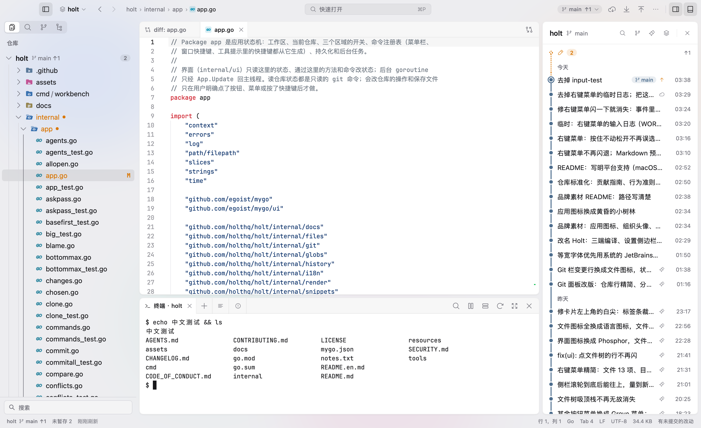
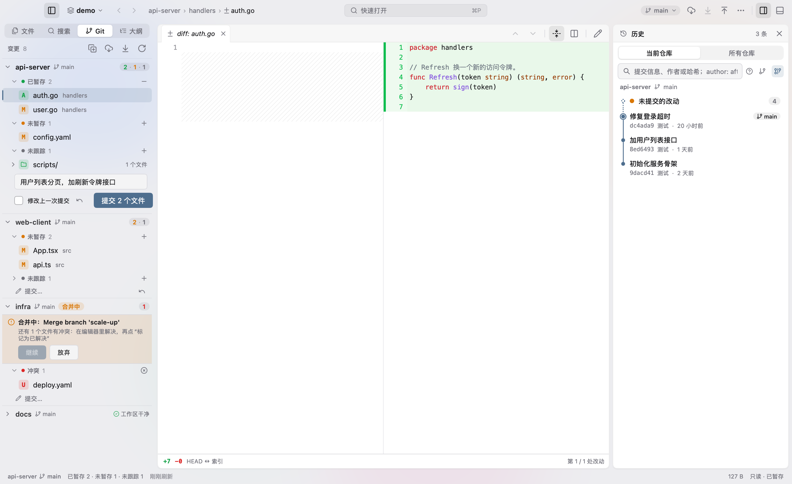
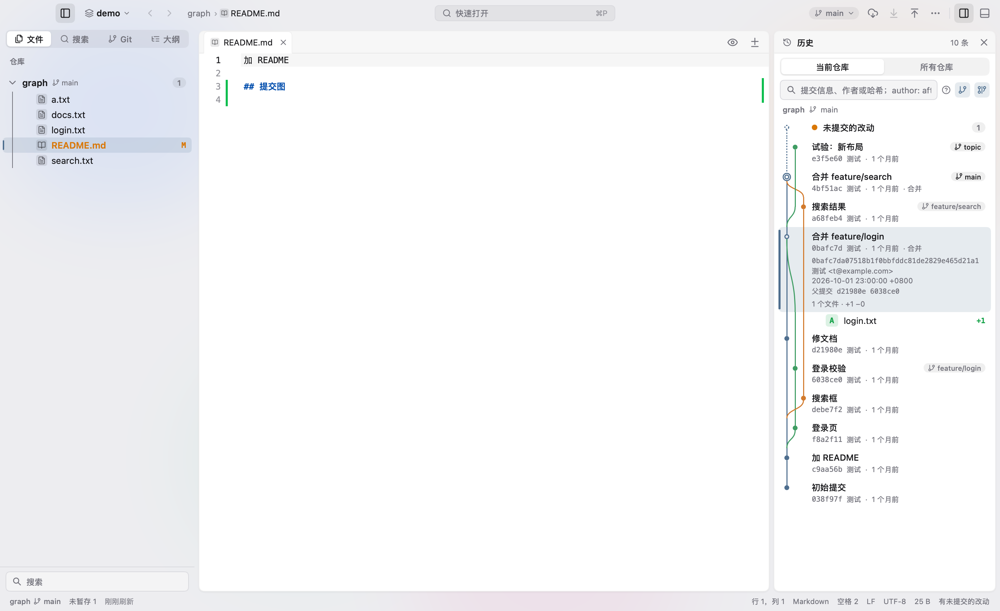
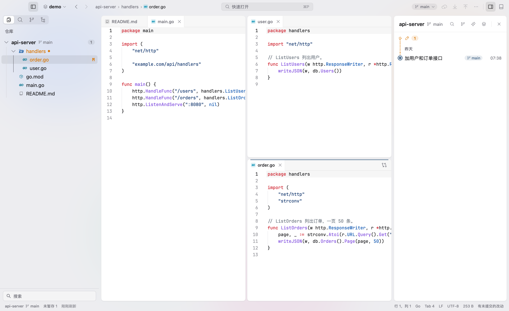
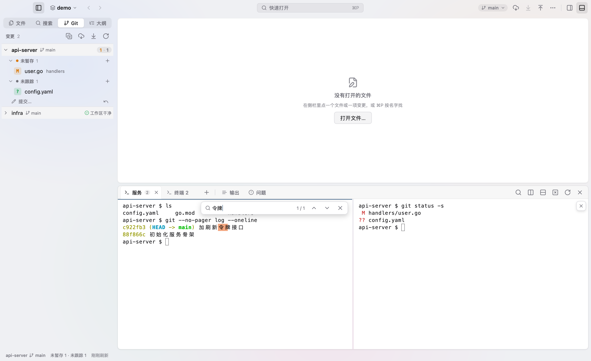

# Holt

[](https://github.com/holthq/holt/actions/workflows/ci.yml)
[](https://github.com/holthq/holt/releases)

[中文](README.md) · English

Holt is a multi-repo workbench for macOS. Browse files, edit code, review Git changes and commit history, and use
terminals in one window. The file tree and Git bar show every repo in your workspace, so you can review their
changes together.

Holt is written in Go, with a native UI drawn by [mygo](https://github.com/egoist/mygo). With five repos open, it uses
about 79 MiB of memory when idle.

Holt is a fork of [Grove](https://github.com/lemoeade/grove): the UI and the core grew out of it, under the same MIT
license and the original author's copyright notice.



## Download

The latest version is on the [Releases](https://github.com/holthq/holt/releases) page: download
`holt-<version>-arm64.dmg` and drag Holt into Applications.

- macOS 13 or later, Apple Silicon (arm64).
- The app is ad-hoc signed and not notarized by Apple: the first time, **right-click Holt → Open** (or run
  `xattr -dr com.apple.quarantine /Applications/Holt.app`). After that, double-clicking works normally.
**Other platforms (preview, runtime not verified)**

- Linux: `holt-<version>-linux-amd64.tar.gz` / `-arm64.tar.gz` (extract and run `./install.sh`, which installs into
  `~/.local`), or `holt_<version>_amd64.deb` / `holt_<version>_arm64.deb` (`sudo dpkg -i …`).
- Windows: `Holt-<version>-windows-amd64.zip` / `-arm64.zip`; unzip and run `Holt.exe`.
- These build and pass CI, but have not been verified on real machines yet. On Windows the terminal daemon (`termd`)
  is a stub, so terminals only run inside the window.

## Three principles

- **Every repo visible at once**: the file tree and Git bar show all repos. Search, history and terminals are also
  organized by repo.
- **You decide when to make changes**: automatic refreshes only run read-only Git commands, with
  `GIT_OPTIONAL_LOCKS=0` to leave the index unchanged. Staging, committing, pushing and other write operations require
  your input. Operations that could cause data loss ask for confirmation first.
- **No automatic uploads**: Holt only connects to the network when you start a Git fetch / pull / push / clone, click
  Check for Updates, or a preview loads a remote image. There is no telemetry, and your code is never uploaded.

## Features

| | |
| --- | --- |
|  |  |
|  |  |

- **Workspace**: open a `.code-workspace` file or a folder, with support for multiple windows. Select and drag files
  across repos in the file tree, and undo the last file operation.
- **Editor**: drag a tab to an edge to split the editor. Includes an outline, sticky scroll, snippets and Markdown
  previews with Mermaid and math. Supports encodings such as GB18030 and Big5. Run formatters like gofmt and prettier,
  or checks like go vet and eslint, on save.
- **Git**: stage changes by hunk or line and resolve conflicts in the editor. View a commit graph for one repo, or the
  history of all repos merged by time; commits co-authored by a coding agent are marked and can be filtered. Merge, rebase (including interactive rebase), cherry-pick, stash, worktree and submodule operations
  are available in the UI. Each repo's header in the Git panel has its own Pull and Push buttons, with ahead / behind
  commit counts; in each repo the commit box sits at the top: a single input line, whose button appears once there is a message and says how many files it will commit; with nothing staged it commits all changes, untracked files included, and its ▾ holds Commit and Push, Amend Last Commit and Undo Last Commit. Change rows show the same file icon as the file tree, with M / A / D at the row end; when space runs out the path shrinks before the filename. Untracked files share the "Changes" group with unstaged
  changes, group buttons appear on hover, and worktrees and stashes are hidden by default — turn on "Show worktrees / stashes in the Git panel" under
  Settings → Git (Stash and Pop Stash work either way). With worktrees shown, each worktree is an agent's desk: one row with a single status mark (waiting for you, running, ready to
  merge, has changes, idle, merged); expand it to see what it adds over the main branch, review it, or merge it into main.
  A collapsed worktree group shows the most urgent mark on its header.
  A "Needs you" bar at the top lists worktrees across all repositories that are waiting or ready to merge, with previous /
  next buttons to jump between them. Git actions that are greyed out say why ("Push (in sync with origin)"), and button tooltips show the
  git command they run.
  Hovering (or selecting with the keyboard) a changed file shows inline Open File, Discard Changes and Stage / Unstage
  buttons; with the list focused, Space stages / unstages and ⌘⌫ discards, acting on all selected rows.
- **Terminals**: each repo has its own set of terminals, built on Ghostty's libghostty-vt, with split panes. Layout
  and output are saved when you close the window. When an agent such as claude or codex runs in a terminal, its tab
  shows whether it is waiting for you (an amber dot: it rang the bell or sent a notification; gone once you switch in)
  or running (a spinner); more agent commands can be added in Settings.
- **Search and navigation**: search and replace across repos. Use ⌘P to find files, ⇧⌘P to open the command palette
  and ⌘T to jump to symbols; ⇧⌘[ / ⇧⌘] switch to the previous / next tab and ⌃Tab goes back to the last used tab.
- **Local history**: each save keeps a snapshot to help recover content you changed or deleted by mistake.
- **Other features**: Chinese and English UI (Chinese by default; change it in Settings), light and dark themes,
  customizable shortcuts, and Check for Updates in the app menu and the About window (reads releases from GitHub).

## Platform support

macOS 13+ on Apple Silicon is supported. Linux and Windows have preview builds (see Download) that compile and pass
CI, but their runtime has not been verified on real machines yet: on Windows the terminal daemon (`termd`) is a stub,
so terminals only run inside the window. If you want to help bring those platforms up, see
[CONTRIBUTING.md](CONTRIBUTING.md).

## Building from source

To run Holt from source (for development or your own changes):

```bash
git clone https://github.com/holthq/holt.git
cd holt
GOTOOLCHAIN=auto go tool mygo build -skip-dmg -skip-notarize -sign -
open build/darwin-arm64/Holt.app
```

mygo is listed in `go.mod` and doesn't need a separate installation. If your Go version is too old,
`GOTOOLCHAIN=auto` downloads the required version. See [docs/release.md](docs/release.md) (Chinese) for signing,
notarization and DMG packaging instructions.

## Usage

Press ⌘O to open a folder or a `.code-workspace` file, or run `open -a Holt <path>` from the command line.
Use ⌘1–9 to jump to the corresponding repo and ⌘J to show or hide the terminal; ⇧⌘J maximizes the bottom panel over the editor area (press again, or double-click the blank part of its header, to restore).
See [docs/shortcuts.md](docs/shortcuts.md) for the full shortcut list.

Settings and sessions are saved in `~/Library/Application Support/Holt/`. Logs are saved in `~/Library/Logs/Holt/`.

## Known limitations

- No LSP support, so there's no code completion or go-to-definition.
- macOS on Apple Silicon is supported; Linux and Windows are previews that have not been verified on real machines.
- No automatic updates (use Check for Updates in the app menu) and no plugin system.

## Feedback

Please open an [issue](https://github.com/holthq/holt/issues) for bugs or ideas. Report security issues privately as
described in [SECURITY.md](SECURITY.md).

## Development

```bash
GOTOOLCHAIN=auto go vet ./...
GOTOOLCHAIN=auto go test ./...
```

UI tests render in memory without opening a window. Tests that write to repos only use temporary repos.
Read [AGENTS.md](AGENTS.md) before changing code. Other documentation is in [docs/](docs/) (mostly Chinese), and
version changes are listed in [CHANGELOG.md](CHANGELOG.md).

## Contributing

Pull requests are welcome in English or Chinese. Start with [CONTRIBUTING.md](CONTRIBUTING.md): build, tests,
screenshots for UI changes, i18n for new text. By participating you agree to the
[Code of Conduct](CODE_OF_CONDUCT.md). Report security issues privately as described in [SECURITY.md](SECURITY.md),
not in a public issue.

## Thanks

[mygo](https://github.com/egoist/mygo), egoist's [godiff](https://github.com/egoist/godiff) and
[kero](https://github.com/egoist/kero), libghostty-vt from [Ghostty](https://ghostty.org),
[JetBrains Mono](https://www.jetbrains.com/lp/mono/), [Mermaid](https://mermaid.js.org) and
[MathJax](https://www.mathjax.org). Other third-party components and their licenses are in
[resources/licenses/](resources/licenses/).

## License

[MIT](LICENSE)

## Links

[linuxdo](https://linux.do)
